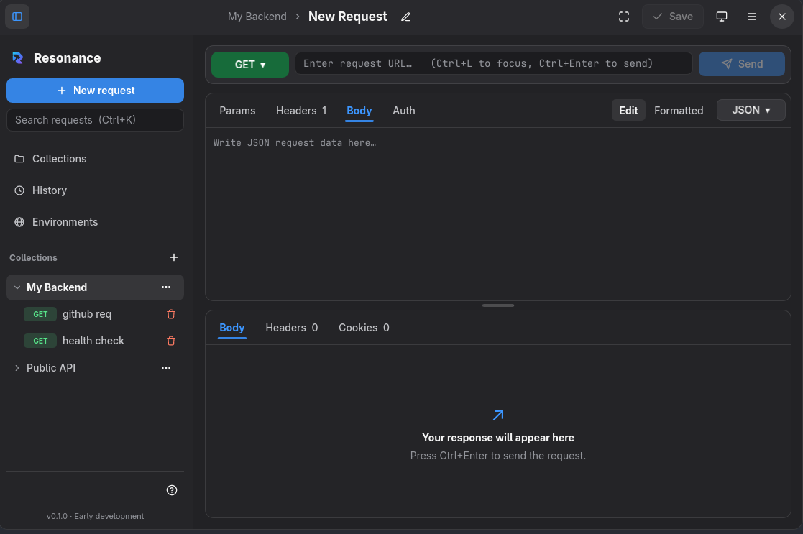
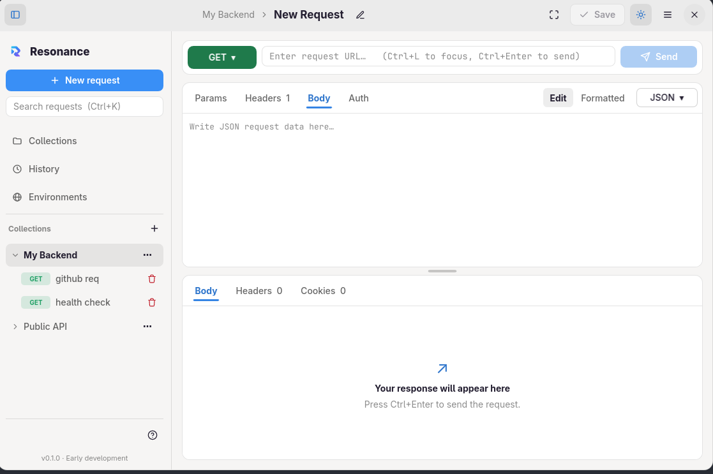
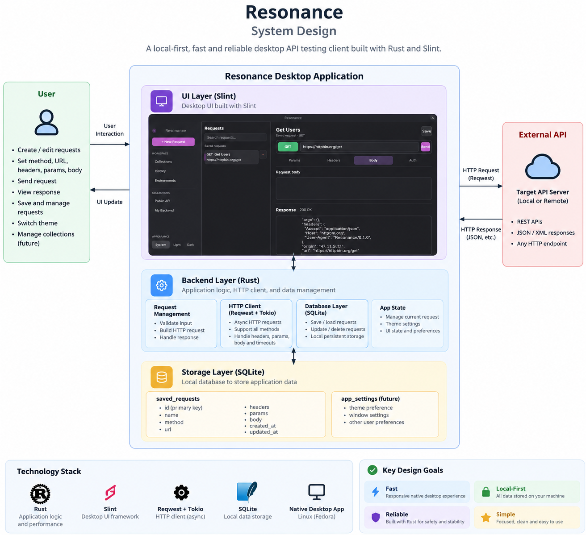

# Resonance

**A lightweight desktop API testing client built with Rust and Slint.**

Resonance started with a simple idea: I wanted an API testing tool that felt fast, reliable, and straightforward to use, with a local-first approach to storing my requests.

As a backend developer familiar with Python and Go, I wanted to build something useful while exploring Rust and desktop application development.

This project is my attempt to do both.

## Screenshots

<table>
  <tr>
    <td align="center"><strong>Dark Mode</strong></td>
    <td align="center"><strong>Light Mode</strong></td>
  </tr>
  <tr>
    <td></td>
    <td></td>
  </tr>
</table>


## Why I Started This

Testing APIs is a regular part of backend development. I wanted a desktop tool that kept the workflow simple and didn't introduce unnecessary complexity.

My main goals are:

- **Speed:** A responsive desktop experience with minimal unnecessary overhead.
- **Reliability:** Predictable request handling and dependable local storage.
- **Local-first:** Keep saved requests and application data on the local machine.
- **Security-conscious:** Be deliberate about how request data is handled and avoid unnecessary data collection.
- **Simplicity:** Focus on the things I need when working with APIs.

These are the principles guiding the project, not claims that every goal has already been achieved.

## System Design

Resonance uses a desktop UI built with Slint, a Rust application layer, an HTTP client powered by Reqwest and Tokio, and SQLite for local persistence.



The architecture will evolve as the application grows. The diagram should be read alongside the current implementation, since some components and ideas may still be planned.

## Why Rust?

Python and Go are the languages I'm already familiar with from backend development. Choosing Rust was an opportunity to step outside my comfort zone and understand a different approach to building software.

While working on Resonance, I want to get more comfortable with:

- Ownership and borrowing.
- Error handling and resource management.
- Asynchronous programming.
- Building native desktop applications.
- Designing maintainable application architecture.

I'm not choosing Rust just because it's popular. I want to understand what it offers and where it makes sense for the kind of software I'm building.

## Built With AI Assistance

I'm being open about the development process: **Resonance is being built with AI assistance, including what people often call vibe coding.**

I use AI to explore implementation approaches, generate and refine code, troubleshoot compiler errors, and work through unfamiliar parts of the Rust ecosystem.

That doesn't mean I assume generated code is correct. I still need to test the application, understand the implementation, debug failures, and make decisions about how the pieces fit together.

For me, this project is about building a useful tool while learning through practical experience. I would rather be honest about the process than pretend every line was written without assistance.

## Current Features

- Send HTTP requests and inspect responses.
- Configure request methods and URLs.
- Add request headers, query parameters, and request bodies.
- View HTTP status codes, response times, and response bodies.
- Save, load, update, and delete requests using SQLite.
- Switch between dark, light, and system themes.

Resonance is still in early development, so the current feature set is intentionally limited.

## Install on Linux

A Linux x86-64 executable archive is available from the [latest GitHub release](https://github.com/yashG0/resonance-api-testing-platform/releases/latest). Download `resonance-v0.1.1-linux-x86_64.tar.gz` and extract it:

```bash
tar -xzf resonance-v0.1.1-linux-x86_64.tar.gz
./resonance
```

The archive contains the application executable only. Required Linux system libraries may need to be installed separately. You can also build Resonance from source on the Linux machine where you plan to run it.

### Requirements

- Rust and Cargo 1.92 or newer.
- A C/C++ build toolchain and the Linux libraries used by Slint's desktop backend.

On Debian or Ubuntu, install the system packages with:

```bash
sudo apt update
sudo apt install -y build-essential pkg-config libx11-xcb1 libx11-dev libxcb1-dev libxkbcommon0 libinput10 libinput-dev libgbm1 libgbm-dev
```

Install Rust with [rustup](https://rustup.rs/) if it is not already available. Then clone this repository and build the optimized release binary:

```bash
git clone https://github.com/yashG0/resonance-api-testing-platform.git
cd resonance-api-testing-platform
cargo build --release
```

Run the application with:

```bash
./target/release/resonance
```

The release profile enables thin LTO, one code generation unit, and symbol stripping. Building on the target machine selects its architecture automatically. Slint's Linux package requirements are documented in its [manual setup guide](https://docs.slint.dev/latest/docs/slint/guide/tooling/manual-setup/).

## Local-First, Not Offline HTTP

Resonance stores saved requests locally, helping keep request collections on your machine.

However, sending a request to a remote API still requires network connectivity. Local APIs can be tested without an internet connection when the local server is running and reachable.

Local storage is also not a complete security guarantee. Protecting sensitive data, handling credentials responsibly, and improving error handling remain important considerations as the project develops.

## What's Next?

I'm planning to improve Resonance incrementally, with a focus on:

- A better response viewer with formatted JSON.
- More comfortable request editing.
- Improved response inspection.
- Better error handling and reliability.
- Further security and privacy improvements.

I'd rather make the core experience dependable before adding features simply to increase the feature list.

## Technology Stack

| Technology | Purpose |
|---|---|
| Rust | Application logic |
| Slint | Desktop user interface |
| Reqwest | HTTP client |
| Tokio | Asynchronous execution |
| SQLite | Local persistence |

## Project Status

**Early development — actively evolving.**

Resonance is a personal project and a learning experience. I'm building it to solve a workflow problem of my own while improving my understanding of Rust, systems programming, and software design.

Feedback, suggestions, and constructive criticism are welcome.

---

*Built with Rust, curiosity, and AI-assisted development.*
