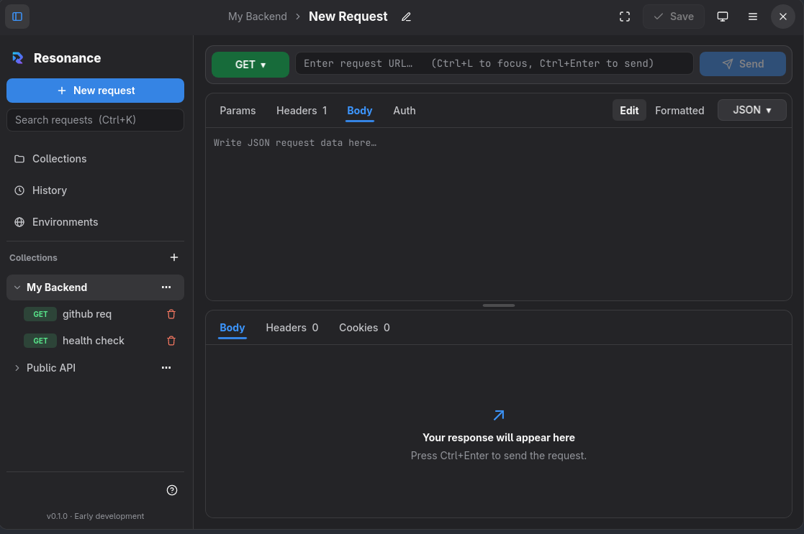
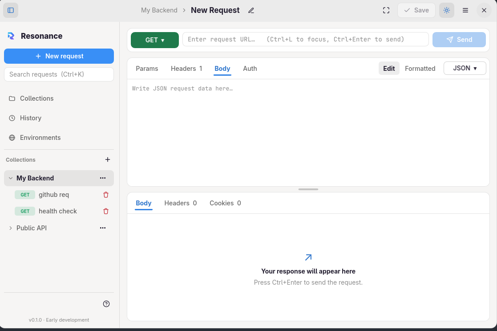
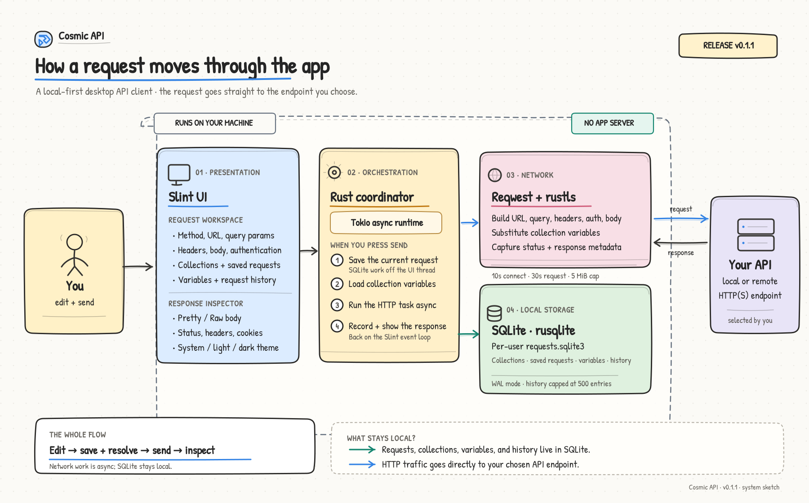

<div align="center">
  
  <h1>Cosmic API</h1>
  <p><strong>A native, local-first API client for building and testing HTTP requests.</strong></p>
  <p>
    
    
    
  </p>
  <p>
    <a href="https://github.com/yashG0/resonance-api-testing-platform/releases">Download Cosmic API</a>
    ·
    <a href="#getting-started">Build from source</a>
    ·
    <a href="#architecture">Architecture</a>
  </p>
</div>

---

Cosmic API helps you create, send, inspect, and repeat API requests from a focused desktop workspace. Requests and collections stay on your machine, while HTTP traffic goes directly to the endpoint you choose.

## At a glance

<div align="center">
  
  <br />
  <sub>Request workspace · dark theme</sub>
</div>

<div align="center">
  
  <br />
  <sub>The same workspace · light theme</sub>
</div>

## What you can do

- **Build HTTP requests** with GET, POST, PUT, PATCH, DELETE, HEAD, and OPTIONS methods.
- **Configure each request** with query parameters, headers, JSON or text bodies, and authentication.
- **Control network behavior per request** with a 100–600000 ms timeout and an option to stop redirects. When enabled, same-origin redirects are followed; cross-origin redirects are always stopped to protect credentials.
- **Organize work** in collections and keep multiple request tabs open with their response state preserved.
- **Reuse values** with collection variables and environment configuration; mark sensitive variables to store their values in the operating-system credential store.
- **Inspect responses** with formatted, raw, and JSON tree views, plus status, timing, headers, and cookies.
- **Check collection responses** with status, status-class, latency, body, JSON Pointer, and response-header assertions.
- **Chain requests** by capturing a JSON Pointer value into a variable for later requests in the same run. Captured values are run-scoped.
- **Control collection runs** with retries, an optional delay, and stop-on-first-failure behavior.
- **Import and copy cURL commands** for common methods, headers, data, and Basic or Bearer authentication. TLS-verification-disabling options are rejected during import.
- **Review regression runs** with per-request outcomes, skipped requests, and response details in a dedicated view.
- **Run collections in CI** with `cosmic-api run "API checks" --database ci-data.sqlite3 --env Staging --data cases.json --junit test-results/api.xml`; a failed request returns a non-zero exit code. `--env` selects another collection's variables as an overlay until named environments are introduced.
- **Review request history** with filtering, sorting, and pagination.
- **Work locally** with SQLite storage and operating-system credential storage for saved secrets.
- **Choose your appearance** with system, light, and dark themes.

## Downloads

Get the latest release from [GitHub Releases](https://github.com/yashG0/resonance-api-testing-platform/releases). Release artifacts are published for:

| Platform | Architecture |
| --- | --- |
| Linux | x86_64 |
| Windows | x86_64 |
| macOS | Intel (x86_64) and Apple Silicon (aarch64) |

See [release notes](RELEASE_NOTES.md) for installation requirements and platform-specific notes. Linux builds require the X11 or Wayland libraries used by Slint. macOS application bundles are currently unsigned and not notarized.

## Getting started

### Build and run

You’ll need Rust 1.88 or newer with Cargo, plus the native libraries required by Slint for your platform.

```bash
git clone https://github.com/yashG0/resonance-api-testing-platform.git
cd resonance-api-testing-platform
cargo run --release
```

To build without launching the app:

```bash
cargo build --release
```

The executable is written to `target/release/`.

The headless runner uses the same OS credential store as the desktop app. It uses the local database by default; pass `--database <file>` to run a prepared SQLite database in CI. A `.json` data file is an array of objects; a `.csv` file uses its first row as variable names. String, number, and boolean JSON values or CSV cell values override collection variables for each iteration. For example:

```json
[
  {"user_id": 1},
  {"user_id": 42}
]
```

The equivalent CSV file can be:

```csv
user_id
1
42
```

For command options and data limits, run `cosmic-api --help`.

### Development checks

```bash
cargo fmt --check
cargo check
cargo test
```

## Architecture

Cosmic API is a native desktop application. The Slint interface collects requests and presents results; Rust coordinates storage and HTTP work; SQLite stores local collections, requests, variables, and recent history. The app does not route API traffic through a Cosmic API server.

See [DESIGN.md](DESIGN.md) for the data flow and current trade-offs, and [BENCHMARKS.md](BENCHMARKS.md) for the available startup sample and the measurements still needed.

<div align="center">
  
  <br />
  <sub>Request flow and local storage boundaries</sub>
</div>

### Technology

| Area | Technology |
| --- | --- |
| Desktop UI | [Slint](https://slint.dev/) |
| Application logic | Rust |
| Async runtime and HTTP | Tokio and Reqwest |
| Local persistence | SQLite via rusqlite |
| Saved credentials | Operating-system credential store |

### Local data and secrets

Authentication credentials and variables marked **Secret** are stored in the operating-system credential store. Other request data—including URLs, headers, query parameters, bodies, and regular collection variables—is stored in the local SQLite database. Request history removes common credential query parameters, URL user information, and URL fragments before saving. Treat the local database as sensitive and use secret variables for tokens and passwords.

## Project status

Cosmic API is under active development. Check the release page and [release notes](RELEASE_NOTES.md) for the current version, supported artifacts, and known platform limitations.

## License

Cosmic API is distributed under the terms in [`LICENSE`](LICENSE).
